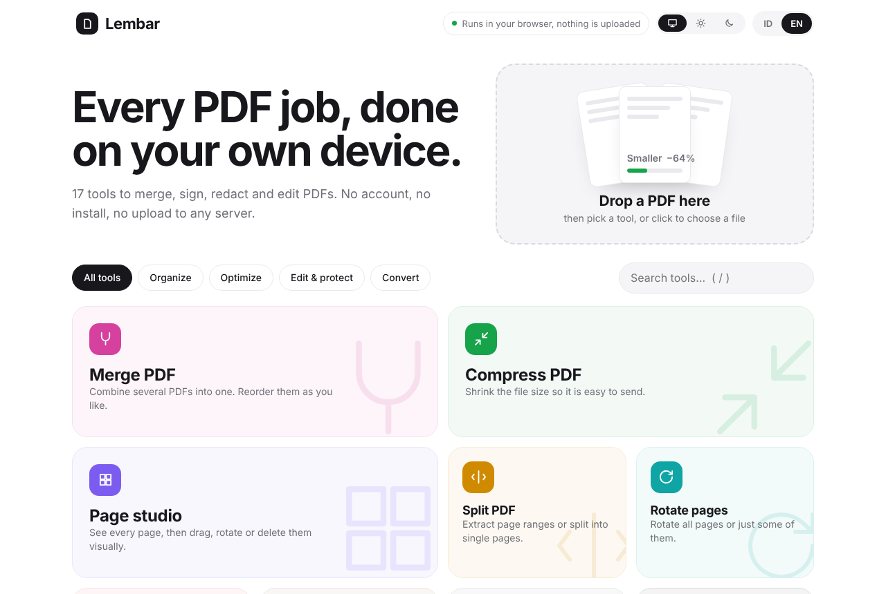
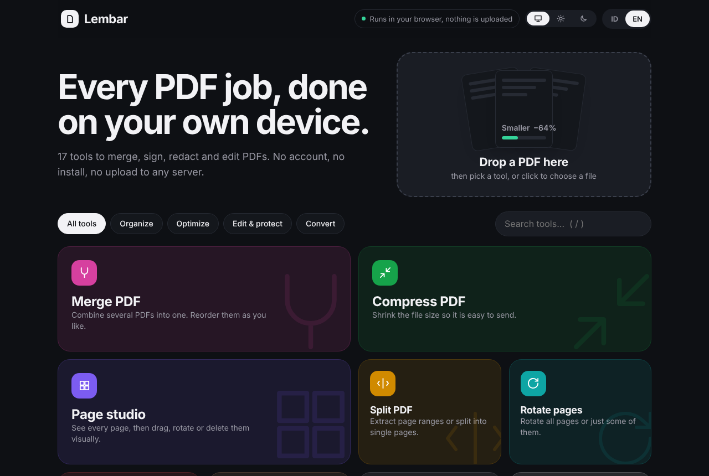
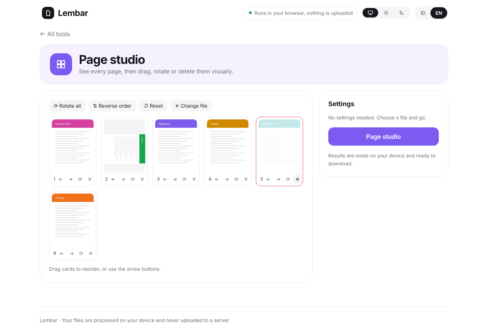

# Lembar

**A private PDF toolkit that runs 100% in your browser.** Merge, split, compress, sign, redact and edit PDFs with no account, no install, and no upload to any server.

🇮🇩 [Baca dalam bahasa Indonesia](README.md)

| Light | Dark |
|---|---|
|  |  |



## Features

17 tools in one page, two languages (Indonesian and English), and a light, dark, or follow-the-browser theme.

| Category | Tools |
|---|---|
| **Organize** | Merge, Split, **Page studio** (drag, rotate, delete visually), Rotate, Crop margins, Multi-page sheets (2, 4 or 6 per sheet) |
| **Optimize** | Compress (3 levels), Grayscale |
| **Edit and protect** | **Sign** (with a pen stabilizer), **Redact** (permanent), Add text, Watermark, Page numbers, Info and privacy (strip metadata) |
| **Convert** | Images to PDF, PDF to images (JPG or PNG), PDF to text |

Also:
- **Result preview** before you download (page viewer with zoom, tabs for zip results).
- **Drag and drop** a PDF on the home page, then pick a tool.
- **Installable on your phone** as an app (PWA) and keeps opening on a weak connection.

## Privacy

All processing happens in your browser with JavaScript. Your PDFs are **never sent** to a server. You can check it yourself: open DevTools (`F12`), go to the **Network** tab, process a PDF, and you will see no request carrying your file.

Small things that still happen: fonts load from Google Fonts, and your hosting provider logs visits to the page (not the contents of any document).

## Run it

Quickest way: download this repository and double-click `index.html`. It already contains every library, so it needs no server and no internet (except for fonts).

To try the PWA and offline cache, run a local server, because service workers only work over `http://` or `https://`:

```bash
python -m http.server 8000
# then open http://localhost:8000
```

## Host it for free

Lembar is a static site, so any free static host works.

**GitHub Pages**
1. Go to **Settings → Pages** in this repository.
2. Under **Build and deployment**, choose **Deploy from a branch**, then branch `main` and folder `/ (root)`. Save.
3. Wait a minute or two. Your address is `https://USERNAME.github.io/REPO-NAME/`.

> On a free GitHub account, GitHub Pages requires a **public** repository.

**Netlify or Cloudflare Pages**: drag the whole folder onto Netlify Drop, or use direct upload on Cloudflare Pages. The `_headers` file is set up for both. GitHub Pages ignores it.

### Optional: link preview image
`src/app.html` contains the text `ALAMAT-SITUSMU` ("your-site-address"). Fill it in at build time so a preview image shows when the link is shared on chat apps and social media:

```bash
SITE_URL=https://USERNAME.github.io/REPO-NAME npm run build
```

Without this the site works normally, only the preview image is missing.

## Build from source

`index.html` is a build output. The code you edit lives in `src/app.html`. `build.mjs` inlines the PDF libraries into a single file.

```bash
npm ci          # install libraries as pinned in package-lock.json
npm run build   # rewrites index.html
```

Requires Node.js 18 or newer. After changing a deployed `index.html`, bump the version in `sw.js` (for example `lembar-v4` to `lembar-v5`) so devices that visited before load the new version.

## Project structure

```
├─ index.html               build output, ready to host
├─ src/app.html             source (HTML, CSS, JS)
├─ build.mjs                build script
├─ package.json             library list (versions pinned)
├─ sw.js                    service worker (offline cache)
├─ manifest.webmanifest     PWA metadata
├─ 404.html, robots.txt, _headers
├─ favicon.svg, *.png       icons and preview image
└─ docs/                    README screenshots
```

## Known limitations

- **No password lock or unlock.** PDF encryption cannot be done purely in the browser with the libraries used.
- **Compress (Balanced and Maximum), Grayscale and Redact** turn pages into images, so their text is no longer selectable. Light compression keeps text intact.
- **Add text, Watermark and Page numbers** support Latin letters only.
- **Redact** matches words within a single line. A word split across two lines is not covered, so check the result in the preview.
- Very large files depend on your browser's memory.

## Built with

Plain JavaScript, no framework, plus:
- [pdf-lib](https://pdf-lib.js.org/) to create and modify PDFs
- [PDF.js](https://mozilla.github.io/pdf.js/) to render pages (preview, images, redaction)
- [JSZip](https://stuk.github.io/jszip/) for zip results

## License

Lembar's code is [MIT](LICENSE) licensed. Third-party libraries keep their own licenses: pdf-lib (MIT), PDF.js (Apache-2.0), JSZip (MIT or GPL-3.0), and the Bricolage Grotesque and DM Sans fonts (SIL Open Font License). License notices stay in the libraries' code.
