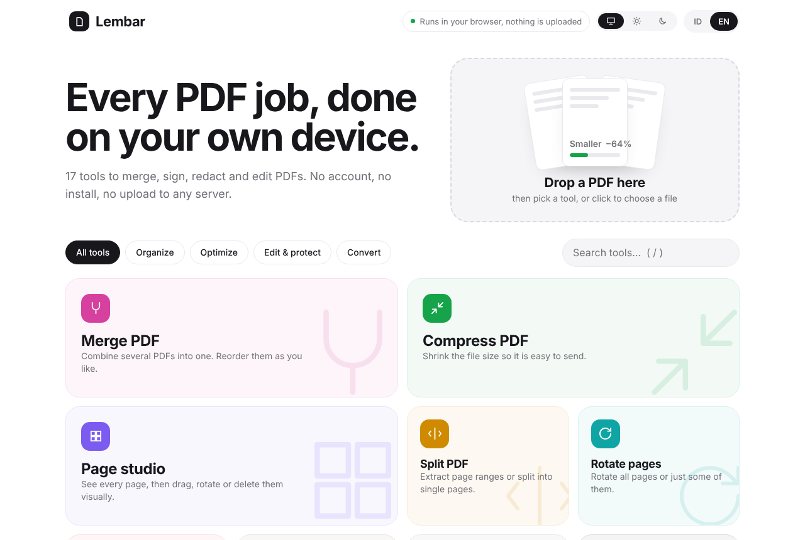
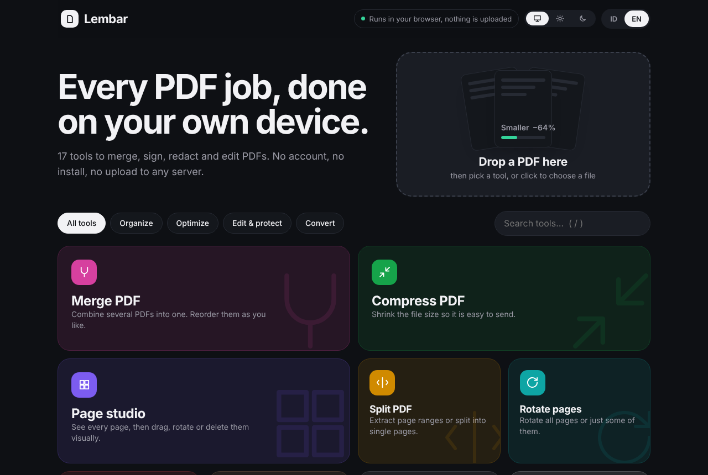
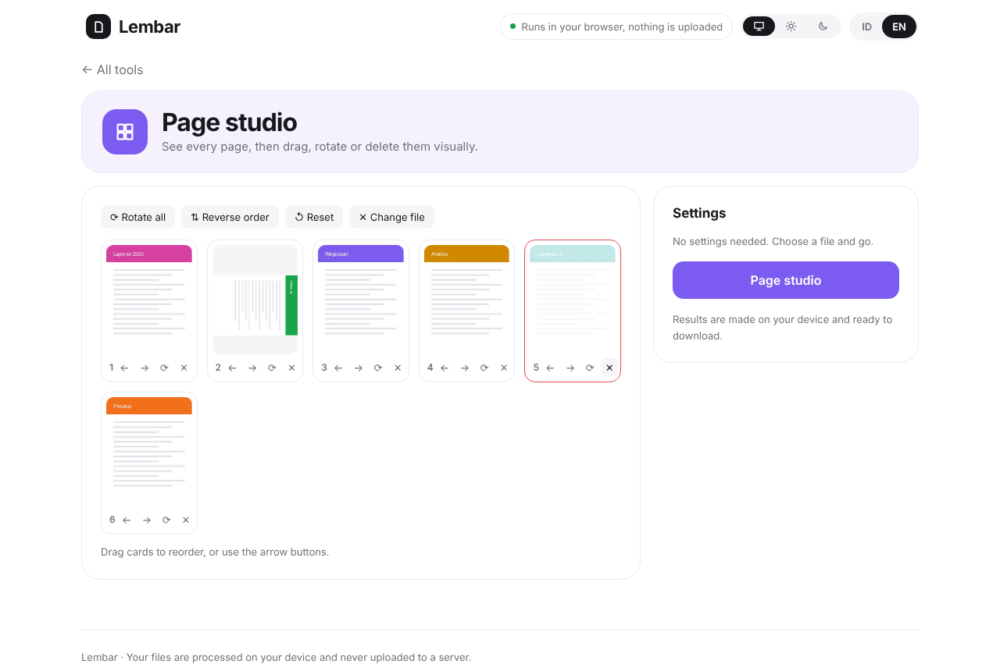

# Lembar

**Alat PDF pribadi yang berjalan 100% di browser.** Gabung, pisah, kecilkan, tanda tangan, sensor, dan edit PDF tanpa akun, tanpa instal, dan tanpa mengunggah file ke server mana pun.

🇬🇧 [Read in English](README.en.md)

| Terang | Gelap |
|---|---|
|  |  |



## Fitur

17 alat dalam satu halaman, dua bahasa (Indonesia dan Inggris), dan tema terang, gelap, atau mengikuti browser.

| Kategori | Alat |
|---|---|
| **Atur halaman** | Gabung PDF, Pisah PDF, **Studio halaman** (geser, putar, hapus secara visual), Putar halaman, Potong tepi, Beberapa halaman per lembar (2, 4, atau 6) |
| **Optimalkan** | Kecilkan PDF (3 tingkat), Hitam putih |
| **Edit dan lindungi** | **Tanda tangan** (dengan stabilizer pena), **Sensor teks** (permanen), Tambah teks, Watermark, Nomor halaman, Info dan privasi (hapus metadata) |
| **Konversi** | Gambar ke PDF, PDF ke gambar (JPG atau PNG), PDF ke teks |

Selain itu:
- **Pratinjau hasil** sebelum diunduh (penampil halaman dengan zoom, tab untuk hasil zip).
- **Seret dan lepas** PDF langsung di beranda, lalu pilih alatnya.
- **Bisa dipasang di HP** seperti aplikasi (PWA) dan tetap terbuka saat sinyal buruk.

## Privasi

Semua pemrosesan berjalan di browsermu memakai JavaScript. File PDF **tidak pernah dikirim** ke server. Kamu bisa membuktikannya: buka DevTools (`F12`), tab **Network**, lalu proses sebuah PDF, dan tidak ada permintaan yang membawa file-mu.

Hal kecil yang tetap terjadi: font dimuat dari Google Fonts, dan layanan hosting yang kamu pakai mencatat kunjungan ke halaman (bukan isi dokumen).

## Menjalankan

Cara tercepat: unduh repositori ini, lalu klik dua kali `index.html`. File ini sudah berisi semua pustaka, jadi tidak butuh server atau internet (kecuali untuk font).

Mau mencoba fitur PWA dan cache offline? Jalankan server lokal, karena service worker hanya aktif lewat `http://` atau `https://`:

```bash
python -m http.server 8000
# lalu buka http://localhost:8000
```

## Memasang secara gratis

Lembar adalah situs statis, jadi bisa dipasang di hosting statis gratis.

**GitHub Pages**
1. Buka **Settings → Pages** di repositori ini.
2. Pada **Build and deployment**, pilih **Deploy from a branch**, lalu branch `main` dan folder `/ (root)`. Simpan.
3. Tunggu satu sampai dua menit. Alamatnya `https://USERNAME.github.io/NAMA-REPO/`.

> Akun gratis GitHub mensyaratkan repositori yang **publik** untuk GitHub Pages.

**Netlify atau Cloudflare Pages**: seret seluruh folder ke Netlify Drop, atau pakai unggah langsung di Cloudflare Pages. Berkas `_headers` sudah disiapkan untuk keduanya. GitHub Pages mengabaikannya.

### Opsional: pratinjau saat link dibagikan
Di `src/app.html` ada tulisan `ALAMAT-SITUSMU`. Ganti saat membangun supaya gambar pratinjau tampil di WhatsApp dan media sosial:

```bash
SITE_URL=https://USERNAME.github.io/NAMA-REPO npm run build
```

Tanpa langkah ini situs tetap berfungsi normal, hanya pratinjau gambarnya yang tidak muncul.

## Membangun dari kode sumber

`index.html` adalah hasil build. Kode yang kamu edit ada di `src/app.html`. Pustaka PDF disisipkan ke dalam satu file oleh `build.mjs`.

```bash
npm ci          # memasang pustaka sesuai package-lock.json
npm run build   # menulis ulang index.html
```

Butuh Node.js 18 atau lebih baru. Setelah mengubah `index.html` yang sudah dipasang, naikkan nomor versi di `sw.js` (misalnya `lembar-v4` menjadi `lembar-v5`) supaya perangkat yang pernah membukanya memuat versi baru.

## Struktur proyek

```
├─ index.html               hasil build, siap pasang
├─ src/app.html             kode sumber (HTML, CSS, JS)
├─ build.mjs                skrip build
├─ package.json             daftar pustaka (versi dikunci)
├─ sw.js                    service worker (cache offline)
├─ manifest.webmanifest     metadata PWA
├─ 404.html, robots.txt, _headers
├─ favicon.svg, *.png       ikon dan gambar pratinjau
└─ docs/                    tangkapan layar untuk README
```

## Batasan yang perlu diketahui

- **Tidak ada kunci dan buka kunci kata sandi.** Enkripsi PDF tidak bisa dilakukan murni di browser dengan pustaka yang dipakai.
- **Kecilkan PDF mode Seimbang dan Maksimal, Hitam putih, dan Sensor teks** mengubah halaman menjadi gambar, sehingga teksnya tidak bisa dipilih lagi. Mode Ringan menjaga teks tetap utuh.
- **Tambah teks, watermark, dan nomor halaman** hanya mendukung huruf Latin.
- **Sensor teks** mencari kata dalam satu baris. Kata yang terpotong antar baris tidak ikut tertutup, jadi periksa hasilnya di pratinjau.
- File yang sangat besar bergantung pada memori browser.

## Teknologi

JavaScript murni tanpa framework, dengan:
- [pdf-lib](https://pdf-lib.js.org/) untuk membuat dan mengubah PDF
- [PDF.js](https://mozilla.github.io/pdf.js/) untuk menampilkan halaman (pratinjau, gambar, sensor)
- [JSZip](https://stuk.github.io/jszip/) untuk hasil berupa zip

## Lisensi

Kode Lembar berlisensi [MIT](LICENSE). Pustaka pihak ketiga memakai lisensinya sendiri: pdf-lib (MIT), PDF.js (Apache-2.0), JSZip (MIT atau GPL-3.0), dan font Bricolage Grotesque dan DM Sans (SIL Open Font License). Keterangan lisensi pustaka tetap tercantum di dalam kodenya.
